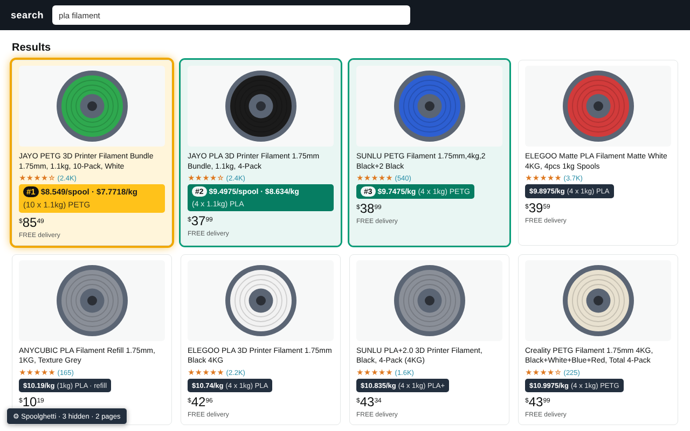

<p align="center"></p>

<h1 align="center">Spoolghetti</h1>
<p align="center"><b>Check the math.</b><br>True price per kg on Amazon.com 3D printer filament searches, best deals sorted to the top, junk filtered out.</p>

<p align="center">
  <a href="https://chromewebstore.google.com/detail/mbclhfbdlfjfhlgcmbkhikdodmiidebc">Chrome Web Store</a> ·
  <a href="https://wendsell.github.io/spoolghetti/">Website</a> ·
  <a href="https://wendsell.github.io/spoolghetti/privacy.html">Privacy</a> ·
  <a href="https://github.com/wendsell/spoolghetti/issues">Report a problem</a>
</p>



## What it does

- **Price per kg on every listing**, plus price per spool when spools aren't 1 kg. Handles packs, bundles, `4 x 1.1kg`, `250g x 8`, pounds, and listings that only show a per-ounce price (marked `~`).
- **Best deals on top.** The whole search sorts cheapest per kg first. #1 gets a gold outline, #2 and #3 green.
- **Whole search, not just page one.** Extra result pages load automatically in the background (up to 7 by default).
- **Junk filtered out.** Storage boxes, dryers, holders, 3D pen refills, sample packs, and tiny spools (250 g by default) are hidden.
- **Filters** for material (PLA, PLA+, PETG, ABS, ASA, TPU, Nylon, PC), brand, and spool-less refills. Settings sync across your Chrome devices.
- **Only on filament searches.** Search for anything else and it does nothing.
- **Private.** No tracking, no analytics, no servers.
- **Free software.** GPLv3 or later. Read it, change it, share it.

## Install

**[Get it on the Chrome Web Store](https://chromewebstore.google.com/detail/mbclhfbdlfjfhlgcmbkhikdodmiidebc)** (works in Chrome, Edge, Brave, and other Chromium browsers).

**From source:**

1. Download or clone this repo.
2. Open `chrome://extensions` and turn on **Developer mode**.
3. Click **Load unpacked** and pick the `extension/` folder.
4. Search Amazon.com for filament.

**Userscript (no extension needed):**

Don't want to install an extension? Same code, as a userscript.

1. Install a userscript manager: [Tampermonkey](https://www.tampermonkey.net/) or [Violentmonkey](https://violentmonkey.github.io/).
2. Open **[spoolghetti.user.js](https://raw.githubusercontent.com/wendsell/spoolghetti/main/userscript/spoolghetti.user.js)** and click **Install** when your userscript manager asks.
3. Search Amazon.com for filament.

It updates itself from this repo. Differences from the extension: settings are saved per browser instead of syncing across devices.

**Only run one.** If you have both the extension and the userscript turned on, every card gets two badges. Settings carry over when you switch from the userscript to the extension.

**Firefox:** the userscript should work in Firefox through Tampermonkey or Violentmonkey (untested there so far). A native Firefox add-on is planned, see [`store/firefox/`](store/firefox/README.md).

## Repo layout

| Path | What it is |
|---|---|
| `extension/` | The extension (Manifest V3). Load this folder unpacked. |
| `userscript/` | Generated userscript for Tampermonkey / Violentmonkey. Don't edit it directly. |
| `platforms/firefox/` | Firefox-only manifest keys, merged in at build time. |
| `scripts/build.sh` | Builds the store zips into `dist/` and regenerates the userscript. |
| `store/chrome/` | Chrome Web Store listing copy, privacy answers, screenshots, promo tiles. |
| `store/firefox/` | Placeholder and checklist for a future addons.mozilla.org release. |
| `docs/` | GitHub Pages site (homepage and privacy policy). |
| `PRIVACY.md` | Privacy policy. |

## Build

```
scripts/build.sh              # everything
scripts/build.sh chrome       # Chrome zip in dist/
scripts/build.sh firefox      # Firefox zip in dist/
scripts/build.sh userscript   # regenerate userscript/spoolghetti.user.js
```

All the logic lives in `extension/content.js`. The userscript is that same file with a userscript header on top, so after changing `content.js` (or bumping the version in `manifest.json`), run `scripts/build.sh userscript` and commit the result. Userscript installs auto-update from the copy on `main`.

Needs `zip` and `python3`.

## When it breaks

Amazon changes its page markup a few times a year. If badges stop showing up, the selectors near the top of the DOM section in `extension/content.js` (`CARD_SEL`, `getPrice`, `getTitle`) are the usual suspects. Open an issue with the search URL and a screenshot.

## License

Spoolghetti is free software: you can redistribute it and/or modify it under the terms of the [GNU General Public License](LICENSE) as published by the Free Software Foundation, either version 3 of the License, or (at your option) any later version.

It is distributed in the hope that it will be useful, but WITHOUT ANY WARRANTY; without even the implied warranty of MERCHANTABILITY or FITNESS FOR A PARTICULAR PURPOSE. See the [GNU General Public License](LICENSE) for more details.

Copyright (C) 2026 wendsell. The icons, screenshots and promo images in this repo are covered by the same license.

---

Spoolghetti is an independent project and is not affiliated with or endorsed by Amazon.
